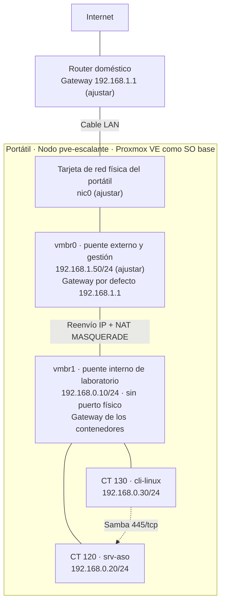

# 02 · Diagrama de red

**Proyecto intermodular · 2º ASIR · Erik Escalante Domenech**

Este diseño es una propuesta que debe comprobarse en mi equipo. Las direcciones marcadas con *(ajustar)* dependen de mi router y se confirmarán en la Fase 3.

## 1. Diagrama



**Lectura del esquema**

- El portátil tiene una única conexión física: un cable LAN al router. Esa tarjeta de red es el único puerto de `vmbr0`.
- `vmbr1` no tiene ningún puerto físico asociado. Es una red solo interna entre el nodo y los dos contenedores.
- Los contenedores salen a internet a través del nodo, que reenvía y aplica NAT con la IP de `vmbr0`.
- El cliente `cli-linux` accede por Samba al servicio de `srv-aso` dentro de `vmbr1`.

## 2. Tabla de direccionamiento

| Elemento | Nombre | IP | Función | Recursos |
| --- | --- | --- | --- | --- |
| Router | — | 192.168.1.1 *(ajustar)* | Gateway y DNS de la red física | — |
| Nodo Proxmox (externo) | `pve-escalante` · `vmbr0` | 192.168.1.50/24 *(ajustar)* | Hipervisor, panel web, salida a internet | *(completar con el inventario de la Fase 1)* |
| Nodo Proxmox (interno) | `pve-escalante` · `vmbr1` | 192.168.0.10/24 | Gateway y NAT de la red de laboratorio | — |
| Servidor ASO | `srv-aso` · CT 120 | 192.168.0.20/24 | Servicio principal (Samba) | *(completar)* |
| Cliente | `cli-linux` · CT 130 | 192.168.0.30/24 | Pruebas | *(completar)* |

**Parámetros de red**

- Red de laboratorio: `192.168.0.0/24`, sin VLAN.
- Gateway de `srv-aso` y `cli-linux`: `192.168.0.10`.
- DNS de los contenedores: `192.168.1.1` (router) o `1.1.1.1` *(decidir y fijar en la Fase 3)*.
- Gateway y DNS del nodo: `192.168.1.1`.

> **Comprobación pendiente:** la red del router no puede solaparse con `192.168.0.0/24`. Algunos routers usan ese rango por defecto. Si el mío lo usa, cambiaré la red de laboratorio a otro rango, por ejemplo `10.10.0.0/24`.

## 3. Puertos necesarios

| Puerto | Protocolo | Origen → Destino | Uso |
| --- | --- | --- | --- |
| 8006 | TCP | Equipo de administración → nodo (`vmbr0`) | Panel web de Proxmox |
| 22 | TCP | Administración / Ansible → nodo y contenedores | SSH |
| 445 | TCP | `cli-linux` → `srv-aso` | Samba (SMB) |
| 139 | TCP | `cli-linux` → `srv-aso` | Samba (NetBIOS), solo si es necesario |
| 53 | UDP/TCP | Contenedores → DNS | Resolución de nombres |
| 80 y 443 | TCP | Contenedores y nodo → internet | Repositorios y actualizaciones |

## 4. Medidas de aislamiento

- `vmbr1` no tiene puerto físico: los contenedores no son accesibles desde la red del router.
- El nodo hace NAT solo de salida. No se configuran redirecciones de puertos desde `vmbr0` hacia `vmbr1`.
- Samba solo se permite entre `192.168.0.20` y `192.168.0.30`.
- El panel `:8006` solo se usa desde `vmbr0` y desde mi equipo. No se expone fuera de la red local.
- El firewall de Proxmox se activa con política de entrada restrictiva y reglas explícitas para los puertos de la sección 3.
- Acceso por SSH con clave y sin login directo de root en los contenedores.
- Contenedores LXC sin privilegios.

El NAT es traducción de direcciones, no una política de aislamiento completa. Las reglas de firewall se validarán en las pruebas de seguridad de la Fase 11.

## 5. Configuración de red propuesta del nodo

Fragmento de `/etc/network/interfaces`, que debe integrarse en el archivo existente sin duplicar bridges ni rutas. El nombre `nic0` y las direcciones de `vmbr0` se ajustarán a mi equipo.

```
auto lo
iface lo inet loopback

iface nic0 inet manual

auto vmbr0
iface vmbr0 inet static
    address 192.168.1.50/24
    gateway 192.168.1.1
    bridge-ports nic0
    bridge-stp off
    bridge-fd 0

auto vmbr1
iface vmbr1 inet static
    address 192.168.0.10/24
    bridge-ports none
    bridge-stp off
    bridge-fd 0
    post-up   sysctl -w net.ipv4.ip_forward=1
    post-up   iptables -t nat -A POSTROUTING -s 192.168.0.0/24 -o vmbr0 -j MASQUERADE
    post-down iptables -t nat -D POSTROUTING -s 192.168.0.0/24 -o vmbr0 -j MASQUERADE

source /etc/network/interfaces.d/*
```

## 6. Validación prevista

- Desde el nodo: `ip route` muestra `default via 192.168.1.1 dev vmbr0` y `192.168.0.0/24 dev vmbr1`.
- Desde `srv-aso` y `cli-linux`: ruta por defecto por `192.168.0.10`, resolución DNS y acceso a repositorios.
- Entre contenedores: ping y acceso Samba de `cli-linux` a `srv-aso`.
- Desde otro equipo de la red física: los contenedores no responden.
- Tras reiniciar el nodo: gestión y NAT siguen funcionando.

[Volver al indice](../README.md)
